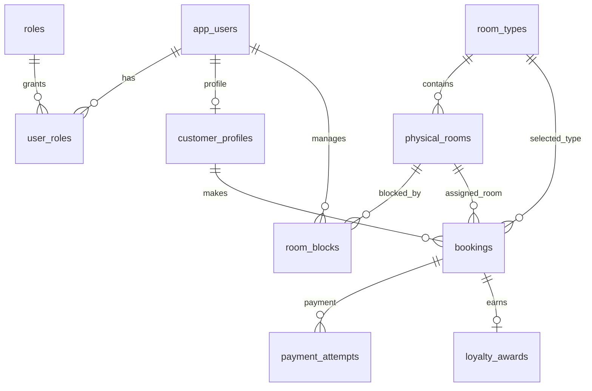

# Database chuẩn cho cả nhóm

Nguồn sự thật là [`V1__initial_schema.sql`](../backend/src/main/resources/db/migration/V1__initial_schema.sql). Database tên `hotel_pms`, PostgreSQL 17, schema mặc định `public`. `docker compose up -d postgres` tạo database local; khi chạy backend, Flyway áp dụng migration V1. Kiểm tra bằng `docker compose exec postgres psql -U hotel_pms -d hotel_pms -c "\dt"`. **Không tự tạo bảng bằng JPA hoặc sửa V1 sau khi nhóm đã áp dụng.**

## Sơ đồ quan hệ

## Tên chuẩn và phạm vi

| Bảng | Mục đích | Package Java phụ trách |
| --- | --- | --- |
| `app_users` | Tài khoản, email, mật khẩu đã hash | `auth` |
| `roles`, `user_roles` | Một tài khoản có thể mang nhiều role | `auth` |
| `customer_profiles` | SĐT, tổng chi tiêu đủ điều kiện, điểm, tier | `auth`, `loyalty` |
| `room_types` | Loại phòng, sức chứa, giá cơ bản mỗi đêm | `room`, `pricing` |
| `physical_rooms` | Phòng vật lý và số phòng duy nhất | `room` |
| `room_blocks` | Khoảng phòng bị chặn, người chặn/mở, lý do | `room` |
| `bookings` | Hold, trạng thái và snapshot giá của một phòng | `booking`, `pricing` |
| `payment_attempts` | Lần thanh toán demo/VNPay và khóa chống ghi lặp | `payment` |
| `loyalty_awards` | Một lần cộng điểm cho mỗi booking đã hoàn tất | `loyalty` |

Các ID là `BIGINT GENERATED BY DEFAULT AS IDENTITY`; JPA dùng `Long` và `GenerationType.IDENTITY`. Tên bảng/cột/index dùng `snake_case`, số nhiều cho bảng, khóa ngoại có dạng `<đối_tượng>_id`. Trong Java dùng `PascalCase` cho class, `camelCase` cho field/JSON: `physical_room_id` ↔ `physicalRoomId`. Không đổi các tên này theo ý từng module; nếu cần đổi, thống nhất trong PR và tạo migration mới.

## Các cột chung quan trọng

- `app_users.email` không phân biệt chữ hoa/thường khi xét duy nhất. Role lưu trong DB là `CUSTOMER`, `STAFF`, `ADMIN` qua `roles.code` và `user_roles`, không có cột role đơn trong user. `GUEST` là người chưa đăng nhập, không có user/role row trong DB.
- `bookings.customer_id` trỏ `customer_profiles.user_id`; `bookings.room_type_id` là loại khách chọn, `physical_room_id` là phòng backend gán. Ràng buộc kép bảo đảm phòng gán thuộc đúng loại.
- `start_at`, `end_at`, `hold_expires_at` là `TIMESTAMPTZ`. Các khoảng có nghĩa `[start_at, end_at)`; hai khoảng chạm nhau ở đầu/cuối không trùng. `room_blocks.released_at IS NULL` nghĩa block còn hiệu lực.
- `bookings.status`: `PENDING_PAYMENT`, `CONFIRMED`, `COMPLETED`, `CANCELLED`, `EXPIRED`. `payment_attempts.status`: `PENDING`, `SUCCEEDED`, `FAILED`. Provider: `DEMO`, `VNPAY`.
- `base_amount`, `discount_amount`, `payable_amount`, `base_price_per_night`, `requested_amount`, `eligible_amount` dùng `NUMERIC(15,2)` / Java `BigDecimal`. `discount_rate` là tỷ lệ 0–1, ví dụ `0.1000` cho 10%.
- `customer_profiles.tier_code`: `STANDARD`, `VIP`, `DIAMOND`. Khi cộng điểm, insert `loyalty_awards` và cập nhật `eligible_spend_total`, `points_balance`, `tier_code` trong cùng transaction.
- `created_at` có default ở DB; `updated_at` **không tự đổi** khi UPDATE. Code cập nhật nó khi sửa hàng. Không xóa cứng phòng hoặc booking có lịch sử.

## Bảo vệ dữ liệu và trách nhiệm của service

- PostgreSQL từ chối hai booking trạng thái đang chiếm phòng nếu khoảng ở chồng lấn cùng `physical_room_id`. Nó cũng từ chối hai RoomBlock còn hiệu lực chồng lấn cùng phòng. Đây là rào cuối cùng; API vẫn phải bắt lỗi constraint và trả HTTP 409 dễ hiểu.
- Không có ràng buộc SQL xuyên hai bảng `bookings` và `room_blocks`: transaction tạo hold/block phải khóa row `physical_rooms`, kiểm tra lại cả hai bảng rồi ghi. Hold quá 15 phút vẫn chiếm phòng cho tới khi job đổi `status` sang `EXPIRED`; job cần chạy đều và xử lý cạnh tranh với thanh toán.
- DB không tính giá, tier, điểm hoặc xác nhận thanh toán. Service kiểm tra `requested_amount` bằng snapshot `payable_amount`; chỉ một payment attempt được `SUCCEEDED` cho một booking. Loyalty chỉ cộng khi booking đã thanh toán và `COMPLETED`.
- `room_blocks` dùng `released_at`/`released_by_user_id` để mở phòng; không xóa row. Điều này giữ lịch sử người chặn và người mở.

## Thay đổi schema

Mỗi PR cần nêu bảng/cột nào thay đổi, migration mới, entity/DTO bị ảnh hưởng và cách kiểm tra. Đặt tên file tiếp theo `V2__ten_thay_doi.sql`, rồi tăng số. Không để `ddl-auto=update`. Khi các thành viên cùng cần V2, thống nhất thứ tự migration trước khi merge. CI khởi động PostgreSQL và backend để kiểm tra Flyway áp dụng được migration mới.
